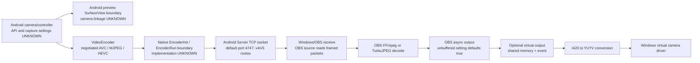

# DroidCam reverse engineering and clone engineering

## Status

Investigation is in progress. This pass covers Android 10.0 service startup, video routes and Java-to-native encoder boundary, ARM64 split library inventory, static extraction of both Windows installers, OBS 2.5.1 source and public virtual-output/client snapshots. Camera backend, native media implementation and shipped Windows receive/decode internals remain open.

## Current findings

- **CONFIRMED** — Android package `com.dev47apps.obsdroidcam`, version `10.0` / code `83`, min SDK 23, target SDK 36. The manifest declares `MainActivity`, `DroidcamService`, camera/microphone permissions, foreground service types `camera|microphone|connectedDevice`, and `hardwareAccelerated=true`. Evidence: `ev_6255da16a238f949e30723ed75a64b08198f518870c273e7bd8ae48a97707416`; APK SHA-256 `e7e166a68e5b991853b031c79273f53e40d953013c2cc781b7248eaa4c9a6162`.
- **CONFIRMED** — `DroidcamService.onCreate()` wires audio, window, connectivity and Wi-Fi services; creates Wi-Fi, optional multicast and partial wake locks; registers a Wi-Fi network callback and screen/network/audio receiver; instantiates a camera-related controller with a `camera2_api` preference selecting integer mode `2` versus `1`. Evidence: `ev_8d96a5b083d27cf6f09e5db5820a4b52bb2de61e80b6d299f334d275d314585d`.
- **CONFIRMED** — `DroidcamService.onDestroy()` removes handler callbacks, tears down the controller, releases held multicast/Wi-Fi/wake locks, closes the server and unregisters callbacks/receivers. `onStartCommand()` returns `1` (Android `START_STICKY` by API constant mapping). Evidence: `ev_fd89574b171d750d1656620cf43681d3c1394a4f7fc8cb39fef7341d2eeb4699`, `ev_5b1bc686fcfa3d5efa309646ffc0f61cba43e36be7cd144c11a3130081c7e811`.
- **CONFIRMED** — the service class directly declares fields typed as `Server`, `Socket`, `ConnectivityManager`, `NetworkCallback`, `WifiLock`, `MulticastLock`, `WakeLock`, `Handler`, and an `AudioManager`. Its methods and related implementation classes are heavily obfuscated, so names alone do not identify data flow. Class summary Evidence: `ev_3ff8f64d4afc1272420fbe5f6063171a81d7ef30b64504dedc0527bf837ae912`.
- **CONFIRMED** — `core.Server` declares native `CheckMDNS()`, `ServiceMDNS(...)` and `StopMDNS()` methods; `libmdns.so` is present in the ARM64 split. The native boundary and library co-exist, but the JNI binding and call sites are not yet joined. Evidence: `ev_446283cb809cfecba425d69453d4562a968f7774f086433d38e6597620802b95`, `ev_a6b77221c0da12af71c78588f97bf7bbaf28c18bb13561776387bb3db082f3a6`, `ev_e87786f3d94d3896b078ba9829eb13e228ac5dd46ea70826b8091ecf5bb3997b`, `ev_3bb9230c106976db56a71ab735b7c7b80abc6b0ff3efbd10d2a0011b8d6f7bf4`.
- **CONFIRMED** — the ARM64 split contains `libmjpg.so`, `libmdns.so`, `libpairipcore.so`, and `libapplovin-native-crash-reporter.so`. Native roles, JNI edges and video call sites remain unverified; the first two names are leads only.
- **CONFIRMED, public source only** — OBS plugin tag `2.5.1` resolves to commit `ddfa8880451f088e19b0358635922cf000bcda6d`, matching the advertised current `master` head at inspection time. It has H.264, H.265 and MJPEG decoder paths, a framed `/video` stream and decoder catch-up/drop logic, plus an OBS “unbuffered output” option enabled by default. This proves source behavior for that commit, not that the supplied installer contains the identical build.
- **CONFIRMED, shipped package** — the Windows client installer is NSIS 3 with an x86 launcher and embedded 64-bit OBS-based client, FFmpeg/OBS/Qt dependencies, DroidCam OBS and virtual-output plugins, plus nested `DroidCam.Drivers.7.1.2.exe`. The standalone 2.5.1 plugin installer and embedded client plugin have different binary hashes/sizes.
- **CONFIRMED, public source only** — the virtual-output plugin uses named shared memory and Windows read/write events, converts I420 to YUYV and drops a frame if its reader lock is not acquired within 5 ms. The custom OBS client creates an output named `droidcam_virtual_output`. This source does not disclose the full kernel driver implementation.

## Documents

- [Environment and evidence](environment.md)
- [Android architecture](android-architecture.md)
- [Android video pipeline](android-video-pipeline.md)
- [Network protocol](network-protocol.md)
- [Windows client](windows-client.md)
- [OBS plugin](obs-plugin.md)
- [Latency analysis](latency-analysis.md)
- [Thermal analysis](thermal-analysis.md)
- [Clone implementation roadmap](clone-implementation-roadmap.md)
- [Open questions](open-questions.md)

## Evidence vocabulary

- **CONFIRMED**: directly shown by the identified artifact/source evidence.
- **INFERRED**: technical conclusion drawn from identified evidence, with the reasoning stated.
- **UNKNOWN**: not established by the current evidence.
- **NEEDS_RUNTIME_VALIDATION**: requires measurement on real devices or the packaged application.

Decompilation output and proprietary binaries are not stored in this documentation. Source references identify paths/functions and commit; Android claims identify class/method and REA Evidence ID.

## Pipeline update

The modern Android service starts a TCP listener (default port 4747) and accepts `/v5/video` and `/v4/video` streaming routes. The observed OBS 2.5.1 source requests `/v5/video`; that is route compatibility evidence, not proof of identical stream bytes. Android negotiates AVC, MJPEG or HEVC tokens, then invokes native encoder entry points. Camera API selection, native codec implementation, surface sharing, encoded framing and Android-side queue policy remain unresolved. The Android SO_SNDBUF request is 256 KiB capacity; it must not be translated into an assumed latency.

## End-to-end model (current evidence)

The Android preview and network encode legs are both represented in code, but their shared capture surface and timing relationship are not established. The `/v5` route is seen on both Android and OBS source; producer/consumer packet framing parity remains unknown. The diagram's decoder/output legs describe the public OBS source snapshot, not the separately hashed standalone client binaries.

## Clone scope

The intended product is an independent DroidCam-style Android-to-Windows camera stream implemented in this repository. The selected first milestone is a vertical slice across both platforms. No application source currently exists here; the repository presently holds this research, configuration, official reference artifacts, and a vertical-slice design proposal. The selected MVP uses a protocol owned by this clone rather than wire compatibility with official apps. The proposed transport is TCP control plus RTP/H.264 over UDP. Product code starts after approval of the design and implementation plan. The clone must be independently implemented and must not incorporate redistributed proprietary code.

## Résolution et fréquence visées

Le premier jalon vise 1920×1080 à 60 fps et doit aussi proposer 1920×1080 à 30 fps. L’application doit interroger les capacités réelles de la caméra et de l’encodeur : la prise en charge 1080p60 dépend du téléphone. Elle ne doit pas basculer silencieusement en 720p ; si 60 fps n’est pas disponible, elle peut proposer 1080p30 et afficher le mode actif. Les combinaisons prises en charge devront être mesurées sur les appareils ciblés. Documentation Android : [tailles et fréquences Camera2](https://developer.android.com/reference/android/hardware/camera2/params/StreamConfigurationMap).
