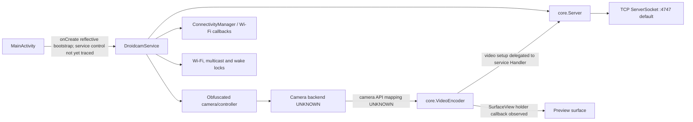

# Android architecture

## Manifest and service lifecycle

**CONFIRMED** — `AndroidManifest.xml` declares `MainActivity` (exported launcher; handles `screenSize|orientation`) and `DroidcamService`, whose foreground service types are `camera|microphone|connectedDevice`. Required permissions include CAMERA, RECORD_AUDIO, INTERNET, network/Wi-Fi state/change, WAKE_LOCK and foreground-service permissions. Application declares hardware acceleration and `extractNativeLibs=false`. Evidence: `ev_6255da16a238f949e30723ed75a64b08198f518870c273e7bd8ae48a97707416`, APK SHA above.

**CONFIRMED** — `DroidcamService.onCreate()` obtains AudioManager, WindowManager, ConnectivityManager and WifiManager; creates a Wi-Fi lock, an optional multicast lock controlled by `allow_wifi_nsd` (default true), and a `PowerManager` wake lock; registers a Wi-Fi `NetworkCallback`; instantiates an obfuscated camera/controller class with a `camera2_api` setting (default false; values 2/1); and listens for screen on/off, NSD state and Bluetooth SCO audio state. Evidence: `ev_8d96a5b083d27cf6f09e5db5820a4b52bb2de61e80b6d299f334d275d314585d`, method `DroidcamService.onCreate()`.

**CONFIRMED** — `DroidcamService.onStartCommand()` returns `1`; mapping this Android service constant to `START_STICKY` means the service asks Android to recreate it after certain process death conditions. It does not prove uninterrupted camera streaming or automatic peer reconnection. Evidence `ev_5b1bc686fcfa3d5efa309646ffc0f61cba43e36be7cd144c11a3130081c7e811`.

**CONFIRMED** — `DroidcamService.onDestroy()` removes pending Handler callbacks, invokes the obfuscated controller teardown, releases multicast/Wi-Fi/wake locks only if held, closes the `Server`, unregisters receiver and network callback, and removes foreground state. Evidence `ev_fd89574b171d750d1656620cf43681d3c1394a4f7fc8cb39fef7341d2eeb4699`.

**CONFIRMED** — `DroidcamService.m17285qkFVOXoBRSAaY(byte[],int)` reads background-stream preferences (`bg_stream`, `keep_active`, `bg_restarts`), resolves the configured camera ID through the camera controller, attaches that controller and optional `NsdManager` to a new `Server`, sets the advertised phone name, and starts the server with `app_port` (default 4747). Evidence: `ev_7e0ea7c936eb83d19e1abbded00cf2306517b0d5f3b429a400e5d824917f2e86`.

**CONFIRMED** — `com.dev47apps.obsdroidcam.core.Server` declares native `CheckMDNS()`, `ServiceMDNS(byte[],byte[],byte[],int)` and `StopMDNS()` methods. The ARM64 split contains `libmdns.so`. **INFERRED** — the native service likely contributes to discovery, but the exact library loader, JNI symbols and call sites are not yet joined. Evidence: Server class `ev_446283cb809cfecba425d69453d4562a968f7774f086433d38e6597620802b95`; native method IDs above.

**CONFIRMED** — `core.Server.run()` creates a TCP `ServerSocket` on the configured port. `accept()` is polled with a 64 ms timeout; accepted sockets enable keep-alive and use a separately configured read timeout (numeric value unresolved). The server starts an mDNS service when the NSD path is enabled. Evidence `ev_2b7cbc18b4b54e9f4aa80a85c628700489822c5484a90407d3234b21eaa9a19c`.

**CONFIRMED** — `core.VideoEncoder.m19797oBRSAaY(SurfaceView)` attaches a `SurfaceHolder.Callback` to a `SurfaceView`, invoking `surfaceCreated` immediately when its surface is already valid. This confirms a preview-surface boundary, but whether the camera writes directly to it, shares it with `MediaCodec`, or uses an intermediate texture remains **UNKNOWN**. Evidence `ev_1a9b77f6ee1e101c88fa0da96508cd7f5822af4316055e5d4f4a3273c9aa1033`.

`core.VideoEncoder` also declares native methods `EncoderInit`, `EncoderRun`, and `EncoderRunBB`. The same split contains `libmjpg.so`; **INFERRED** — these entry points likely provide an MJPEG encode path, but the native library loader/export binding has not been established. Evidence `ev_cba6d7307479eeb756f6733b597aac72912a78fbddf4cfa56f8363d13f35cfad`, `ev_3b4987949da1a7ee27c5e4d3566b09ebc614e3ee95caa47609752f83bf30abff`, `ev_4753b5e1f5d85777ce49397361d6a5d422db48cb05210d532f81030502a7cad6`, `ev_354e030b2fd6396b648b90520ff8b55f3c969098a760c6c02be97dc78ccced2c`.

The call sites establish that the service is designed to survive a connected-device session and observe Wi-Fi/screen changes. They do **not** establish exactly when each lock is acquired or whether the camera uses old Camera API or Camera2 in a given session.

## Initial component graph

The camera capture surface edge and encoded-packet path remain deliberately unasserted. Service startup and the Android `Server` listener are now directly established by method evidence.

## Obfuscation and limits

`DroidcamService` has 25 methods and 28 fields; most names are obfuscated. Fields reveal types including `Server`, `Socket`, `ConnectivityManager.NetworkCallback`, `WifiManager.WifiLock`, `WifiManager.MulticastLock`, `PowerManager.WakeLock`, `Handler` and `AudioManager`. `MainActivity` includes a `SurfaceView`, but the field inventory alone does not prove it is the capture preview surface. See Evidence `ev_3ff8…` and `ev_6f05…`.

**UNKNOWN** — exact Camera API/Camera2 implementation behind the mode flag, capture stream configuration, orientation transforms, AVC/HEVC encoder internals, encoded-frame queueing and native JNI library binding. REA JADX does not decompile ARM64 native code or automatically merge split APKs.

## Audio boundary

**CONFIRMED** — the service has a socket/controller audio setup path that reads audio source, sample rate, channel and AGC preferences, retries an invalid controller state up to twelve times with 100 ms delays, then closes the socket on failure. Exact audio codec, framing and transport coupling are **UNKNOWN**. Evidence `ev_e793badf58bb92476af578f2285d4c7b8bfd45dff2dfb6a27e6da5a4583723c4`.
