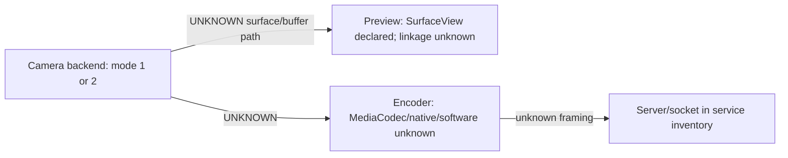

# Android capture and video pipeline

## Findings so far

- **CONFIRMED** — a user preference named `camera2_api`, read in `DroidcamService.onCreate()`, selects controller constructor argument `2` when true and `1` otherwise. This is evidence of two camera modes exposed through the controller boundary; because the consumer class is obfuscated and not yet traced, the exact APIs mapped to those modes remain **UNKNOWN**. Evidence `ev_8d96a5b083d27cf6f09e5db5820a4b52bb2de61e80b6d299f334d275d314585d`.
- **CONFIRMED** — the manifest requires camera support and enables application hardware acceleration. This is not proof of a GPU image-processing path.
- **CONFIRMED** — Android accepts `/v5/video/...` and `/v4/video/...`; `VideoEncoder.m19788ixm()` maps request tokens containing `avc`, `jpg`, and `hevc` to modes 1, 2, and 3. The server parses width×height; its mode-2 MJPEG path rejects heights above 1080. It requests a 262,144-byte socket send buffer before dispatching video setup to the service handler. Evidence `ev_4e70b87346e4367dc30c3d37efb71b323492a80d0ad3f47bb3d1459c2f809fe8`, `ev_d4f4f5054a5cc2201264173bdf2663660a01ac4ff6b1c78c3a7e111a7439afee`, `ev_40912752e1d5c5339ea525a61376d34aff49faec48a0dce6dbc20d22ba2edeb4`.
- **CONFIRMED** — `VideoEncoder` declares native `EncoderInit(int,int)`, `EncoderRun(...)`, and `EncoderRunBB(...)`; a separate method attaches preview via `SurfaceView` holder callback. This proves native encoder entry points and a preview surface in the class, not their internal format, thread, queue or surface-sharing behavior. Evidence `ev_cba6d7307479eeb756f6733b597aac72912a78fbddf4cfa56f8363d13f35cfad`, `ev_3b4987949da1a7ee27c5e4d3566b09ebc614e3ee95caa47609752f83bf30abff`, `ev_4753b5e1f5d85777ce49397361d6a5d422db48cb05210d532f81030502a7cad6`, `ev_354e030b2fd6396b648b90520ff8b55f3c969098a760c6c02be97dc78ccced2c`, `ev_1a9b77f6ee1e101c88fa0da96508cd7f5822af4316055e5d4f4a3273c9aa1033`.
- **UNKNOWN** — exact Camera API/Camera2 mapping, capture stream selection, orientation transforms, frame-rate configuration, AVC/HEVC encoder implementation, profile/bitrate/keyframe settings, capture/encode queue depths and frame dropping. `libmjpg.so` plus native `Encoder*` methods suggest an MJPEG JNI path, but library binding remains unverified.

## Working pipeline model

## Native libraries in ARM64 split

| Library | Size | Interpretation |
|---|---:|---|
| `libmjpg.so` | 870,368 bytes | **INFERRED lead only** for MJPEG processing based on filename; exports, JNI and call sites not inspected. |
| `libmdns.so` | 116,640 bytes | **INFERRED lead only** for mDNS/NSD support; runtime use not proved. |
| `libpairipcore.so` | 609,416 bytes | third-party protection/runtime component name; no attempt to bypass it. |
| `libapplovin-native-crash-reporter.so` | 843,152 bytes | crash reporter by name; not part of media path absent evidence. |

No Ghidra, IDA, NDK `llvm-objdump` or other ARM64 analyzer is available in the environment. Treat filename-level roles as hypotheses until JNI exports, DEX native declarations and call references are joined. The DEX JNI declarations are now confirmed; symbol/library binding remains open.

**CONFIRMED native boundary** — `core.Server.CheckMDNS()`, `ServiceMDNS(...)` and `StopMDNS()` are declared native. `libmdns.so` co-exists in the ARM64 split, but exact library loading/JNI symbol mapping is not established. The Java video native boundary is now confirmed through `VideoEncoder.Encoder*`; its implementation and library binding remain unknown. `libmjpg.so` is not identified as the encoder based on name alone.

## Execution path refined

**CONFIRMED** — service startup reads background-stream preferences, resolves the selected camera through its controller, attaches that controller and optional NSD manager to `core.Server`, and starts it on the configured app port (default 4747). Evidence `ev_7e0ea7c936eb83d19e1abbded00cf2306517b0d5f3b429a400e5d824917f2e86`.

**CONFIRMED** — `core.Server.run()` opens a `ServerSocket`, uses a 64 ms accept timeout, sets keep-alive on accepted sockets, routes streaming requests to a worker thread and dispatches video setup to the service Handler. Evidence `ev_2b7cbc18b4b54e9f4aa80a85c628700489822c5484a90407d3234b21eaa9a19c`, `ev_4e70b87346e4367dc30c3d37efb71b323492a80d0ad3f47bb3d1459c2f809fe8`, `ev_d4f4f5054a5cc2201264173bdf2663660a01ac4ff6b1c78c3a7e111a7439afee`.

**CONFIRMED** — `VideoEncoder.mo19796qkFVOXoBRSAaY(...)` stores negotiated stream parameters, selects an internal encoder adapter based on client/codec values, logs resolution, bitrate, FPS, keyframe interval/max-quality-like fields and calls native `EncoderInit(width,height)`. Those parameter fields are demonstrably passed/logged here, but their exact semantics and units beyond the log labels require field tracing. Evidence `ev_667ef84ac0aa2b8d43a457e9316fb49fd411c438b96ffe956213b38e4159f639`.

**CONFIRMED** — modern protocol tokens map to `avc`, `jpg`, and `hevc`; native `EncoderInit`, `EncoderRun`, `EncoderRunBB` form a native boundary. `VideoEncoder.mo19793...()` calls native `EncoderRelease()` on teardown. Exact JNI library implementation and whether AVC/HEVC use Android `MediaCodec` remain **UNKNOWN**. Evidence `ev_40912752e1d5c5339ea525a61376d34aff49faec48a0dce6dbc20d22ba2edeb4`, `ev_3b4987949da1a7ee27c5e4d3566b09ebc614e3ee95caa47609752f83bf30abff`, `ev_4753b5e1f5d85777ce49397361d6a5d422db48cb05210d532f81030502a7cad6`, `ev_354e030b2fd6396b648b90520ff8b55f3c969098a760c6c02be97dc78ccced2c`, `ev_013ce4bef5129e14c99389b8c00dee234adf47cb2cdb1e5ae00e0a645060aaa2`.

**UNKNOWN** — camera-to-encoder call edge, per-frame native buffer ownership, codec implementation, bitstream framing, frame dropping/backpressure and preview/encode surface sharing. Do not treat the `SurfaceView` callback as proof of direct camera-to-surface streaming.
