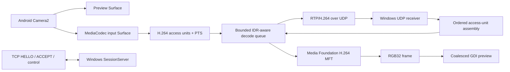

# Clone implementation status

Date: 2026-10-25

This note records what is present in the independent clone after the first Android-to-Windows vertical slice. Compile success is not evidence that a device combination sustains its advertised frame rate or that the complete session works at runtime.

## Implemented path

Android offers 1280×720 and 1920×1080 modes only when both Camera2 and a surface-input H.264 encoder report support. It offers 60 fps and 30 fps profiles, preferring an exact fixed AE FPS range and otherwise the narrowest range ending at the target; 1080p30 is the default when supported. Resolution changes remain an explicit user selection. Normally Camera2 targets both the on-phone preview and MediaCodec encoder surfaces; DIM removes the preview target from the repeating request while leaving the encoder target active, then restores the preview target on tap. The encoder uses a bounded bitrate, a one-second keyframe interval, and MediaCodec surface input. It records requested/actual MediaCodec format details in logcat. H.264 profile selection stays at the codec default; the Baseline experiment was not retained because it did not show a clear benefit at 1080p30. Encoded access units are packetized as RTP single NAL or FU-A packets. A reversible black full-content overlay hides the UI and system bars; the display remains awake during streaming. A connection attempt can be cancelled from the UI; closing during TCP connect closes the pending socket, and the activity ignores callbacks from a cancelled client.

Android status includes the selected profile, rolling encoder output rate, sent packet count, bounded sender queue depth/age, queue drops, and receiver keyframe requests. Encoded access units carry a local sequence number and monotonic output timestamp for telemetry. Windows reports decoded FPS, hardware/software decoder selection, RTP sequence gaps and reorder events, dropped access units, receive-to-decode duration, and latest-frame age at presentation submission. Phone and PC monotonic clocks are never compared.

Camera2 capture callbacks now expose the sensor timestamp and camera frame number. The Android screen reports camera capture cadence separately from encoder cadence, the age of the last Camera2 capture callback, process CPU per core, battery temperature when reported by Android, and system thermal status. Capture-rate calculation uses differences from the same camera timestamp source only; Android documents that the source may be unknown relative to other clocks ([Camera2 `SENSOR_TIMESTAMP`](https://developer.android.com/reference/android/hardware/camera2/CaptureResult#SENSOR_TIMESTAMP)). Camera FPS drops to zero after callbacks have been absent for two seconds; callback age uses the local monotonic arrival clock. Once per second, the app retains a bounded sample of sender/camera/thermal telemetry and lets the operator export it as CSV through Android's document picker. The selected camera ID is included in the capture status and CSV metadata so comparisons can use the same physical camera. The profile picker lists each reported surface-input H.264 encoder for available 720p/1080p 30/60 profiles, names its hardware/software class when Android exposes it, and uses the selected codec without silently substituting another. GPU utilization and comparative energy/codec-path results still require device-specific measurement.

The sender's UDP queue holds at most two complete access units. When full, it discards the oldest queued unit and favors the newest. The Windows receiver checks RTP version, payload type, peer IPv4 address, SSRC, packet sequence, optional RTP headers and padding. It rebuilds complete access units, rejects units over 8 MiB, expires unfinished units after 100 ms, caches SPS/PPS, and requests an IDR after loss. The Windows message queue coalesces frame notifications so it does not enqueue one UI message per decoded frame.

Windows decoding now runs on its own worker behind a three-access-unit queue. On queue overflow, it drops pending stale units, requests an IDR, and discards later non-IDR units until a valid recovery point arrives. The receiver also detects 750 ms without RTP traffic, exposes stalled/live state and packet age, and requests one recovery keyframe per stall until traffic resumes. The preview reports queue depth/age, queue drops, whether it is waiting for an IDR, and process CPU as a percentage of one logical core. GPU utilization still needs an external system monitor. These paths bound application-level decode backlog; stall and recovery behavior still need the grouped runtime session.

## Evidence and confidence

Performance checks use the non-debuggable, shell-profileable `benchmark` variant or a signed release APK. The installed debug APK enabled avoidable runtime checks. A first 1080p30 probe fell from 47.14% to 20.54% of one core, but the next benchmark run averaged 43.75%; the apparent reduction was not stable and is not a thermal guarantee. See [thermal analysis](thermal-analysis.md). CI now produces both Android variants, and exported diagnostics record the debuggable flag and camera ID.

Subsequent hardware-counter samples at matched 1080p30 and similar measured clocks recorded 13.7% fewer instructions and 16.6% fewer CPU cycles per image in the benchmark build. The final device UI reported 30.0 camera fps and 30.1 encoder fps with zero sender queue drops in the observed window. Skin temperature remained around 40°C with MODERATE thermal status; sustained thermal acceptance remains open in issue #4.

| Observation | Evidence | Status |
|---|---|---|
| Android uses Camera2 preview and encoder targets | `CameraController.createSession`, `CaptureRequest` targets | CONFIRMED in source |
| Android encoder is H.264 with surface input | `H264Encoder.start`, `COLOR_FormatSurface`, `createInputSurface` | CONFIRMED in source |
| Profiles are 720p/1080p at 30/60 fps based on reported camera and encoder capabilities; 1080p30 is the default when available | `CameraController.queryProfiles`, `H264Encoder.findEncoder`, profile picker | CONFIRMED in source; actual sustained FPS NEEDS_RUNTIME_VALIDATION |
| Android DIM removes the preview target but keeps encoding and the camera session active | `MainActivity.setDimmed`, `CameraController.setPreviewEnabled` | CONFIRMED in source; capture continuity and sustained thermal effect NEEDS_RUNTIME_VALIDATION |
| Control uses TCP 48200 and video uses negotiated UDP/RTP | `SessionProtocol`, `SessionServer`, `SessionClient`, clone protocol v1 | CONFIRMED in source |
| A pending Android connection can be cancelled without starting a late camera session | Connect button state and `SessionClient` socket lifecycle | CONFIRMED in source; behavior NEEDS_RUNTIME_VALIDATION |
| Windows tries hardware Media Foundation decoder activation then synchronous local fallback | `H264Decoder.Start`, `StartSoftware` | CONFIRMED in source; transform availability and behavior NEEDS_RUNTIME_VALIDATION |
| Windows preview currently copies decoded RGB32 frames into GDI | `H264Decoder.Decode`, `WindowProc` / `StretchDIBits` | CONFIRMED in source |
| Windows overlay reports process CPU utilization relative to one logical core | `GetProcessTimes` sampled on the one-second UI timer | CONFIRMED in source; values NEEDS_RUNTIME_VALIDATION |
| Sender and receiver expose local frame-rate, queue-age, packet-loss and presentation-age telemetry | Android `FrameStats`, Windows `RtpH264Receiver` and preview overlay | CONFIRMED in source; values NEEDS_RUNTIME_VALIDATION |
| Android reports Camera2 cadence, frame number, process CPU, battery temperature and thermal status | Camera2 `CaptureResult` callback and sender telemetry view | CONFIRMED in source; values NEEDS_RUNTIME_VALIDATION |
| Android reports zero camera FPS and a rising callback age when capture callbacks stop | `FrameStats` derives cadence from sensor timestamps and freshness from local monotonic arrival time | CONFIRMED in source; behavior NEEDS_RUNTIME_VALIDATION |
| Android can export a bounded per-second session telemetry log as CSV | `MainActivity` sample collection and document-picker export | CONFIRMED in source; file output NEEDS_RUNTIME_VALIDATION |
| Android lets the operator select a reported H.264 surface encoder per profile | `CameraController.queryProfiles`, `H264Encoder.findEncoders`, profile picker | CONFIRMED in source; simultaneous camera/encoder operation NEEDS_RUNTIME_VALIDATION |
| Windows decode backlog is bounded and resumes only at an IDR after overflow | `FreshnessQueue`, Windows receiver callback and keyframe control | CONFIRMED in source; stall/loss recovery NEEDS_RUNTIME_VALIDATION |
| RTP silence is surfaced and prompts a one-shot keyframe request | `RtpH264Receiver::ReceiveLoop` stall timeout and preview overlay | CONFIRMED in source; disconnect/recovery behavior NEEDS_RUNTIME_VALIDATION |
| The route sustains low latency and acceptable Android temperature over a long session | Short device probes collected; matched sustained runs remain in E2E issue #4 | NEEDS_RUNTIME_VALIDATION |

## Known limits

- The Windows renderer is GDI and receives RGB32 system-memory frames. This is a functional baseline, not a zero-copy GPU path; conversion/copy cost may limit 1080p60.
- Media Foundation transform activation, output type negotiation, hardware/software selection, delayed output behavior and device-driver combinations have only been compile-verified.
- Camera profile enumeration uses platform capability reports. Camera/encoder surface combinations can still fail when a session is created, and sustained 60 fps can change with thermal conditions.
- The Windows decode handoff is bounded, but UDP bursts can still accumulate in the OS socket receive buffer. Test the queue's IDR recovery under receiver stalls and packet loss before changing the socket buffer.
- Android preview layout/orientation, camera control UX, actual delivered FPS, end-to-end latency, packet loss behavior, reconnect behavior, CPU/GPU utilization, battery use and temperature have not been observed on devices.
- No Android device was attached during this implementation session (`adb devices -l` returned no devices), so profile availability and runtime telemetry could not be collected.
- Grouped real-device/network validation is tracked in [GitHub issue #4](https://github.com/sangimed/droidcam-re/issues/4); update its checklist and results as implementation and testing progress.
- The protocol is unauthenticated and unencrypted. The Windows receiver binds all IPv4 interfaces and is intended only for a trusted local network.

## Compile evidence

- Android command: `cd android; .\gradlew.bat --no-daemon assembleDebug` — BUILD SUCCESSFUL on 2026-10-25.
- Windows commands: `cmake -S windows -B windows/build -G "Visual Studio 17 2022" -A x64` and `cmake --build windows/build --config Debug` — BUILD SUCCESSFUL with MSVC 19.44 and Windows SDK 10.0.26100.0 on 2026-10-25.
- Automated tests and phone/network runtime sessions have not been run.

## Next implementation priorities

1. Exercise a real Android/Windows session at both offered profiles and verify first-frame decoder configuration, decode-queue overflow recovery, and disconnect/reconnect.
2. Measure actual delivered FPS and stage/queue ages before tuning bitrate, buffer limits or codec settings.
3. Move Windows decode and presentation toward a D3D11-aware path if measurements show RGB32/GDI is the bottleneck.
4. Measure phone CPU, battery and temperature over sustained sessions; no device measurements have been collected.
