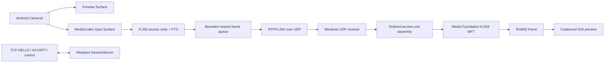

# Clone implementation status

Date: 2026-10-24

This note records what is present in the independent clone after the first Android-to-Windows vertical slice. Compile success is not evidence that a device combination sustains its advertised frame rate or that the complete session works at runtime.

## Implemented path

Android exposes only 1920×1080 modes that Camera2 and a surface-input H.264 encoder report as supported. It offers 60 fps and 30 fps independently; it reports unsupported modes instead of changing resolution. Camera2 targets both the on-phone preview and MediaCodec encoder surfaces. The encoder uses a bounded bitrate, a one-second keyframe interval, and MediaCodec surface input. Encoded access units are packetized as RTP single NAL or FU-A packets.

The sender's UDP queue holds at most two complete access units. When full, it discards the oldest queued unit and favors the newest. The Windows receiver checks RTP version, payload type, peer IPv4 address, SSRC, packet sequence, optional RTP headers and padding. It rebuilds complete access units, rejects units over 8 MiB, expires unfinished units after 100 ms, caches SPS/PPS, and requests an IDR after loss. The Windows message queue coalesces frame notifications so it does not enqueue one UI message per decoded frame.

## Evidence and confidence

| Observation | Evidence | Status |
|---|---|---|
| Android uses Camera2 preview and encoder targets | `CameraController.createSession`, `CaptureRequest` targets | CONFIRMED in source |
| Android encoder is H.264 with surface input | `H264Encoder.start`, `COLOR_FormatSurface`, `createInputSurface` | CONFIRMED in source |
| Profiles are 1080p30/60 based on reported camera and encoder capabilities | `CameraController.queryProfiles`, `H264Encoder.findEncoder` | CONFIRMED in source; actual sustained FPS NEEDS_RUNTIME_VALIDATION |
| Control uses TCP 48200 and video uses negotiated UDP/RTP | `SessionProtocol`, `SessionServer`, `SessionClient`, clone protocol v1 | CONFIRMED in source |
| Windows tries hardware Media Foundation decoder activation then synchronous local fallback | `H264Decoder.Start`, `StartSoftware` | CONFIRMED in source; transform availability and behavior NEEDS_RUNTIME_VALIDATION |
| Windows preview currently copies decoded RGB32 frames into GDI | `H264Decoder.Decode`, `WindowProc` / `StretchDIBits` | CONFIRMED in source |
| The route achieves low latency or lowers Android temperature | No runtime measurements collected | UNKNOWN |

## Known limits

- The Windows renderer is GDI and receives RGB32 system-memory frames. This is a functional baseline, not a zero-copy GPU path; conversion/copy cost may limit 1080p60.
- Media Foundation transform activation, output type negotiation, hardware/software selection, delayed output behavior and device-driver combinations have only been compile-verified.
- Camera profile enumeration uses platform capability reports. Camera/encoder surface combinations can still fail when a session is created, and sustained 60 fps can change with thermal conditions.
- The Windows receiver decodes synchronously on its UDP receive thread. The Windows UI notifications coalesce, but slow decoding can still let datagrams accumulate in the OS socket buffer. A bounded receive/decode handoff or lower socket receive buffer should be evaluated with measurements.
- Android preview layout/orientation, camera control UX, actual delivered FPS, end-to-end latency, packet loss behavior, reconnect behavior, CPU/GPU utilization, battery use and temperature have not been observed on devices.
- The protocol is unauthenticated and unencrypted. The Windows receiver binds all IPv4 interfaces and is intended only for a trusted local network.

## Compile evidence

- Android command: `cd android; .\gradlew.bat --no-daemon assembleDebug` — BUILD SUCCESSFUL on 2026-10-24.
- Windows command: `cmake --build windows/build --config Debug` — BUILD SUCCESSFUL with Visual Studio 2022 Build Tools and Windows SDK 10.0.26100.0 on 2026-10-24.
- Automated tests and phone/network runtime sessions have not been run.

## Next implementation priorities

1. Exercise a real Android/Windows session at both offered profiles and verify first-frame decoder configuration and disconnect/reconnect.
2. Measure actual delivered FPS and stage/queue ages before tuning bitrate, buffer limits or codec settings.
3. Move Windows decode and presentation toward a D3D11-aware path if measurements show RGB32/GDI is the bottleneck.
4. Add explicit Windows decoder-mode and packet-loss telemetry, then measure phone CPU, battery and temperature over sustained sessions.
