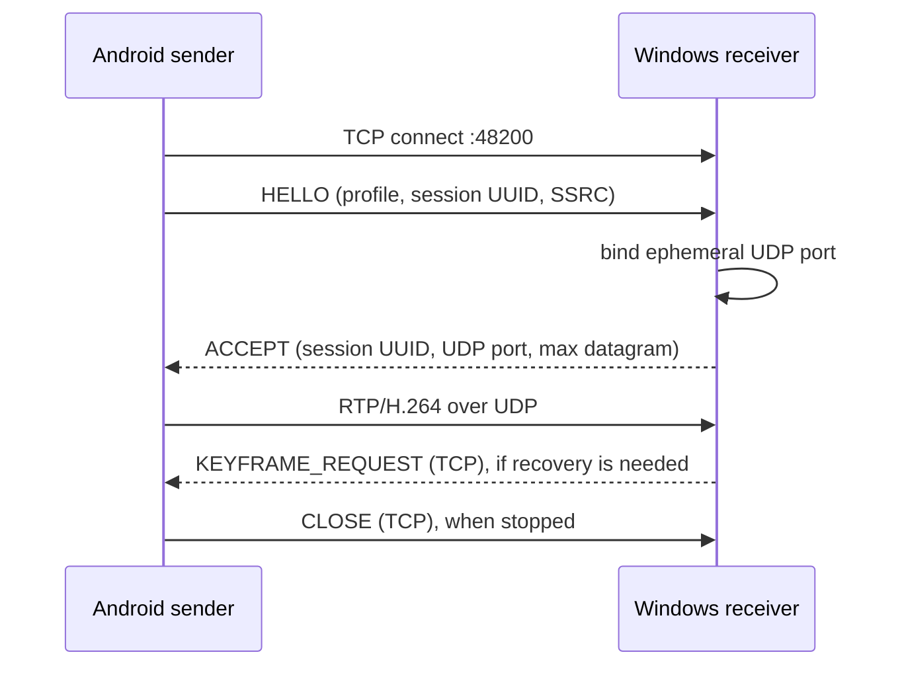

# DroidCam clone protocol v1

This protocol connects only this clone's Android sender and Windows receiver. It is not compatible with DroidCam clients.

## Transport

- TCP session/control: Windows listens on IPv4 port `48200`.
- Video: Android sends RTP/H.264 datagrams over UDP to the UDP port returned by Windows in `ACCEPT`.
- Windows binds an ephemeral UDP port per accepted session. The UDP payload must not exceed 1200 bytes, including the RTP header.
- All control integers are unsigned big-endian. A TCP record is `u32 length` followed by `length` bytes. `length` must be from 2 through 4096 before any payload allocation.
- A TCP record body begins with `u8 version` (`1`) and `u8 message_type`.

## Control records

| Type | Direction | Body after common prefix | Purpose |
|---|---|---|---|
| `HELLO = 1` | Android → Windows | 16-byte session UUID, u16 width, u16 height, u8 fps, u8 codec (`1 = H.264`), u8 dynamic RTP payload type (`96`), u32 SSRC | Request a stream. Version 1 accepts only 1920×1080 at 30 or 60 fps. |
| `ACCEPT = 2` | Windows → Android | 16-byte session UUID, u16 Windows UDP port, u16 maximum RTP datagram payload (`1200`) | Accept the exact offered profile and provide the destination port. |
| `REJECT = 3` | Windows → Android | u16 reason code | Reject unsupported profile/version/session. |
| `KEYFRAME_REQUEST = 4` | Windows → Android | 16-byte session UUID | Request a new H.264 sync frame after packet loss or decoder recovery. |
| `CLOSE = 5` | Either direction | 16-byte session UUID | End the session cleanly. |

Control messages with an unknown version, unknown type, invalid field values, extra/truncated bytes, or oversized record length are rejected and the connection is closed. Only one stream session per Windows receiver is supported in v1.

## RTP/H.264

- RTP version 2, dynamic payload type 96, one SSRC per session, monotonically increasing 16-bit sequence number.
- RTP timestamp uses the 90 kHz H.264 clock and derives from MediaCodec presentation timestamps. The marker bit is set on the final RTP packet of each access unit.
- Support single-NAL packets and FU-A fragmentation. An RTP packet exceeding the negotiated 1200-byte UDP payload limit is rejected.
- Receiver drops an access unit if any sequence is missing, it remains incomplete for 100 ms, its SSRC or TCP peer address does not match, or its reconstructed size exceeds 8 MiB. It never submits partial access units to the decoder.
- Codec configuration (SPS/PPS) is sent in-band before the first IDR and after encoder reconfiguration. The Windows receiver caches SPS/PPS and prepends them to an IDR if the encoder emitted them in a separate access unit. A receiver sends `KEYFRAME_REQUEST` when it cannot resume from the current reference chain.
- There is no retransmission, FEC, encryption, authentication, or internet/NAT traversal in v1. Use only on a trusted local network.

## Session lifecycle

