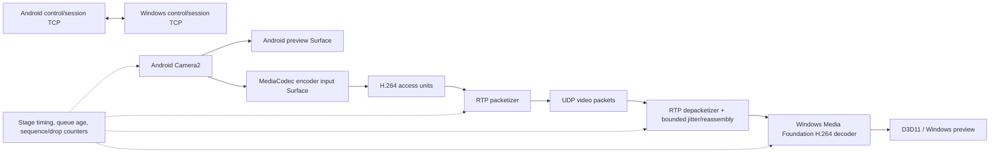

# DroidCam clone vertical slice — design proposal

Date: 2026-10-24

## Intent

Build an independent Android-to-Windows camera-streaming application in this repository. The first milestone is a runnable end-to-end slice: Android camera preview and H.264 encode, stream to a Windows receiver, display a Windows preview, and measure frame freshness and stage latency. It is a separate product and will not reuse proprietary DroidCam code.

The workspace currently contains reverse-engineering documents and official reference artifacts, but no app source, build configuration, or implementation language choices. This design proposes a clean new project structure. It deliberately separates the clone’s protocol and implementation from DroidCam’s undocumented native behavior.

## Platform compatibility proposal

- Android minimum API: 23, matching the studied modern DroidCam package. Compile and target API: 36, matching the studied app target.
## Goals

- Prove one Android camera → encode → transport → Windows decode → preview path.
- The Android app and Windows client built for this clone will communicate with each other using their own protocol. They will not be designed to connect to the official DroidCam Android app or Windows client.
- Make frame age, sequence, drops, queue depth, and per-stage time observable from the first slice.
- Prefer hardware codec paths when supported, with a documented software fallback if practical.
- Bound sender and receiver application queues so overload is visible and stale frames do not accumulate silently.

## Non-goals for the first slice

- Interoperation with DroidCam Android, Windows, or OBS binaries.
- Audio, camera switching, torch/zoom controls, mDNS discovery, USB/ADB transport, pairing/authentication UI, or background streaming.
- Windows virtual-camera driver/output. The first Windows output is an application preview.
- Exact reproduction of DroidCam protocol, visual design, or proprietary implementation.

## Constraints and evidence

- Android source evidence confirms the official app’s service and `/v4`/`/v5` routes, but its capture API and native encoder implementation remain unknown. The clone should make independent choices.
- Android’s `MediaCodec.createInputSurface()` supports encoder surface input; Camera2 can target preview and encoder surfaces when the camera reports a compatible stream combination. Device support and thermal/latency benefit must be measured, not assumed. References: [Android MediaCodec](https://developer.android.com/reference/android/media/MediaCodec#createInputSurface()), [CameraDevice](https://developer.android.com/reference/android/hardware/camera2/CameraDevice).
- Windows Media Foundation documents H.264 encode/decode support; a Direct3D 11-aware Media Foundation pipeline can share video surfaces with a D3D device, with a possible software fallback when a compatible hardware configuration is unavailable. References: [Media Foundation supported formats](https://learn.microsoft.com/en-us/windows/win32/medfound/supported-media-formats-in-media-foundation), [D3D11 decoding](https://learn.microsoft.com/en-us/windows/win32/medfound/supporting-direct3d-11-video-decoding-in-media-foundation).
- RFC 6184 specifies H.264 NAL unit packetization for RTP, including sequence numbers, a 90 kHz media clock, access-unit marker bit, aggregation and fragmentation. It supplies a standard video packet format without making this clone interoperable with DroidCam. Reference: [RFC 6184](https://www.rfc-editor.org/rfc/rfc6184).

## Approaches considered

1. **TCP-framed H.264 for control and video.** Simplest to inspect and get running, but stream loss or a slow receiver can create head-of-line delay; application queue limits cannot remove bytes already queued by TCP.
2. **Independent control TCP plus H.264 RTP/UDP for video — recommended proposal.** Uses TCP for session setup and control, and sequence/timestamped RTP packets for video. A late or missing packet can be discarded and the receiver can request/await a keyframe. More packetization and loss handling work, but it fits the live-preview latency goal and avoids inventing H.264 framing.
3. **WebRTC.** Provides an established real-time media stack and mature transport behavior, but adds a large dependency, configuration surface, and a heavier build/integration task on Android and native Windows for this first local-network slice.

## Proposed architecture

### Android sender

- Kotlin application, using Camera2 and MediaCodec for explicit camera stream and encoder configuration.
- Target 1920×1080 at 60 fps and provide 1920×1080 at 30 fps as a selectable profile. Query the camera's advertised output sizes and frame-rate ranges plus the encoder's supported size/rate range before offering either mode. Do not silently substitute 720p. If 1080p30 is unsupported, report that clearly; if 1080p60 is unsupported or cannot be sustained, offer 1080p30 and show the selected rate. Negotiate the chosen profile with Windows.
- Configure Camera2 to target a preview surface and MediaCodec input surface when the selected device advertises a supported stream combination. Provide a fallback path only if required for the first device matrix; measure conversion cost before committing to CPU YUV copies.
- Extract encoded access units, parameter sets, and presentation timestamps from MediaCodec output, then packetize according to RFC 6184. Preserve keyframe and codec configuration behavior across session start/reconnect.
- Start with user-entered Windows IPv4 address on the same LAN. Do not implement discovery or USB in this slice.

### Windows receiver

- Native C++ desktop receiver with a minimal window, control TCP session, UDP/RTP receiver, H.264 depacketizer, Media Foundation decoder, and preview renderer.
- Keep the RTP receive/reassembly and decoder submission queues bounded. Detect missing/incomplete access units, discard stale frames, and recover at a valid keyframe rather than feeding arbitrary partial H.264 data.
- Prefer a D3D11-backed decode/render path where supported. Fall back to a software decoder or report unsupported configuration; do not require a virtual-camera driver for this milestone.
- Expose receive FPS, decode FPS, queue age, packet loss, frame drops, selected codec, and hardware/software decode mode in a diagnostic overlay or log.

### Session protocol and security boundary

- TCP is used only for session negotiation and control in this proposal; video is carried separately over UDP using RTP/H.264.
- Define a small versioned session handshake: protocol version, session ID, selected video port, codec/profile, dimensions, frame rate, and RTP clock/SSRC details. Keep message lengths bounded and reject unsupported values.
- First slice is a trusted local-LAN prototype and has no pairing/security UX. Document this as an explicit prototype limitation and do not expose a listener to the public internet. Add authentication/encryption before any production or untrusted-network use.
- UDP loss behavior is freshness-oriented. Receiver records loss/reordering, drops incomplete access units at a bounded deadline, and requests a keyframe over the control channel if recovery is needed.

## Observability and validation

Record monotonic timestamps and frame/packet identifiers at camera availability (where available), encoder output, packet send, packet receive, decoder output, and presentation submission. Do not subtract phone and PC monotonic clocks unless a mapping/synchronization method is established. For glass-to-glass latency, use a visible LED/stimulus and high-speed recording as an independent check.

The milestone is acceptable when:

- Both applications negotiate a session and display a live stream on a controlled LAN.
- Frame age and stage durations can be read from logs/overlay; sequence gaps, drops, queue depth, and packet loss are visible.
- Simulated receiver stalls or packet loss do not create unbounded application queues; the receiver resumes at a valid decodable picture.
- Camera/codec capability failures are reported cleanly, and one known Android/Windows device combination is documented.
- A sustained 1920×1080 60 fps run is attempted on a capable device; 1920×1080 30 fps is also exercised. Record actual delivered FPS, dropped frames, CPU, GPU/codec mode, battery/temperature trend, and latency percentiles. If the tested phone cannot support a profile, record the capability result and report it instead of lowering resolution. No numerical latency or thermal target is claimed until a baseline is measured.

## Risks and decisions left to the builder

- Android devices vary in simultaneous camera preview/encoder surface support, H.264 profiles, keyframe requests, and low-latency encoder behavior.
- Media Foundation transform selection and D3D11 interop vary by Windows version, GPU, and driver; software fallback may add CPU load and copies.
- RTP packetization and recovery require careful handling of codec configuration and incomplete access units. A minimal implementation must not silently decode malformed partial frames.
- UDP works for local LAN but needs explicit port/firewall handling; USB/ADB and discovery are later transport/discovery adapters.
- A clear first device matrix and Windows minimum version should be recorded during implementation setup.

## Approval boundary

This is a proposal, not authorization to modify product code. After approval, write an implementation plan and then implement the vertical slice in this repository. No official artifacts are part of the implementation target.
